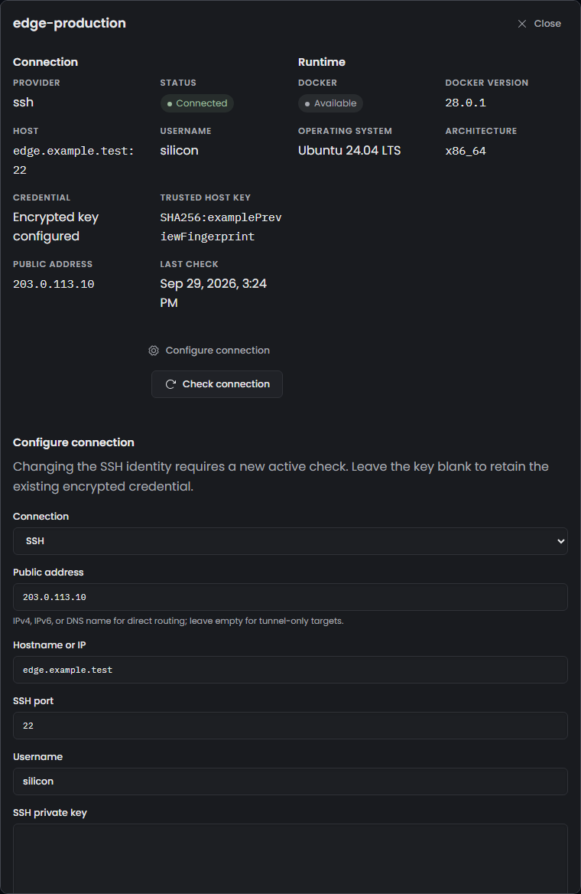
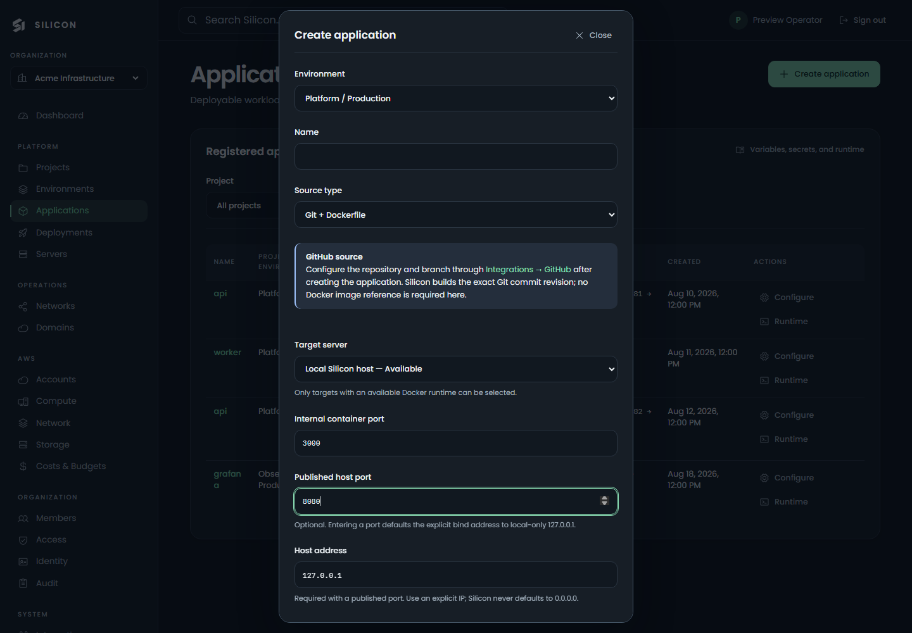

# Install Silicon and publish your first site

Start with a small test website. It gives you a working server, application, and deployment you can use to check each step before moving real data.

## 1. Pick two addresses

- **Panel address** is where you sign in to Silicon. In this example the Linux machine is at `192.168.1.25` and the panel is at `http://192.168.1.25:8080`.
- **Application address** is where people open your site. The test site starts at `http://127.0.0.1:18080` on the Linux server, then can get a name like `app.example.com`.

Replace the example address and domain with your own. Perform the first setup on a private network. Keep port 8080 off public internet until you configure HTTPS.

## 2. Install on Linux

1. Sign in to the Linux machine that will run the panel. Install Docker Engine and its Compose plugin using the instructions for your Linux distribution. Confirm that `docker version` shows a server and `docker compose version` works in the account you will install with.
2. Open [Silicon's releases](https://github.com/itsmangooo/Silicon/releases). Pick a published stable release such as `v0.1.12`. Set `TAG` below to the exact release you selected.
3. Download the installer from that release and review it before running it.

   ```sh
   TAG=v0.1.12
   curl -fsSL "https://raw.githubusercontent.com/itsmangooo/Silicon/$TAG/install.sh" -o silicon-install.sh
   less silicon-install.sh
   sh silicon-install.sh --version "$TAG" --http-port 8080 --public-url http://192.168.1.25:8080
   ```

   The public URL should match what you type in the browser, including the HTTP port. If the installer reports a conflict, pick a different free port and change it in both arguments. Leave existing installations on their configured port.
4. Open the URL the installer prints. Use **Register** and save your account details in a password manager. On a new installation the first account can manage installation-wide settings.
5. Make a private backup of the production configuration and database before storing real data. The configuration includes the encryption key needed to recover saved credentials. Follow [Administration](administration.md) for backups and updates.

## 3. Connect a deployment server

1. In Silicon, create an organization, then open **Servers → Add server**. An organization groups the people, servers, and apps you want to manage together.
2. Use a Linux server with Docker and SSH. It can be the same machine as the panel, using a network address reachable from the panel. For a different server, use its reachable private address or DNS name. The default production installation manages Docker workloads through a verified SSH connection.
3. Enter a server name, SSH address and port, and the Linux account that can access Docker. Use an SSH key dedicated to this server. Follow [Servers and SSH](servers.md) to install its public key and verify the host fingerprint directly on the server.
4. In the server details, check the connection. Continue when SSH is **Connected** and Docker is **Available**. An SSH account that can run Docker has significant control over that machine. Keep its key private.



## 4. Deploy a test website

1. Under **Projects**, create `first-site`. Open it and create an environment called `production`. Environments keep separate copies of an app and its settings.
2. Under **Applications → Create application**, select `first-site` and `production`. Choose **Docker image** and enter `nginx:alpine` for this disposable example. Use a versioned tag or digest for a real deployment.
3. Select the connected server. Set the **Internal container port** to `80`. Enter `18080` for **Published host port** and explicitly use `127.0.0.1` for **Host address**. That binding lets programs on the server reach the site without exposing port 18080 to your network.
4. Save the application, open it, and choose **Deploy → Queue deployment**. Check **Deployments** for the result. If it fails, open the deployment for its stage and error, then check **Runtime & logs** for container output when a container exists.
5. On the deployment server, run `curl -I http://127.0.0.1:18080/`. Look for `200 OK`. The `127.0.0.1` address refers to the machine running the command, so use the server terminal here.



## 5. Connect a real workload

- For code in GitHub, follow [GitHub setup](github.md) to connect a GitHub App, grant access only to the intended repository, bind a branch, and verify the deployed commit.
- For a frontend and backend, follow [the two-app walkthrough](frontend-backend-example.md). Browser-side requests use a public API URL. Container-side requests can use the Docker environment network on one server or a configured private network across servers.
- Put ordinary app configuration in **Environment variables** and credentials in **Secrets**. Save changes and redeploy. Add named volumes before relying on a container for persistent storage.
- For a public hostname, choose [Cloudflare Tunnel](cloudflare.md) or [your own Caddy, Nginx, or Traefik proxy](external-proxy.md). Use the separate [Public access](public-access.md) guide if the hostname is for the Silicon panel itself.
- Use [Find a feature](feature-reference.md) to locate the rest of the controls.
