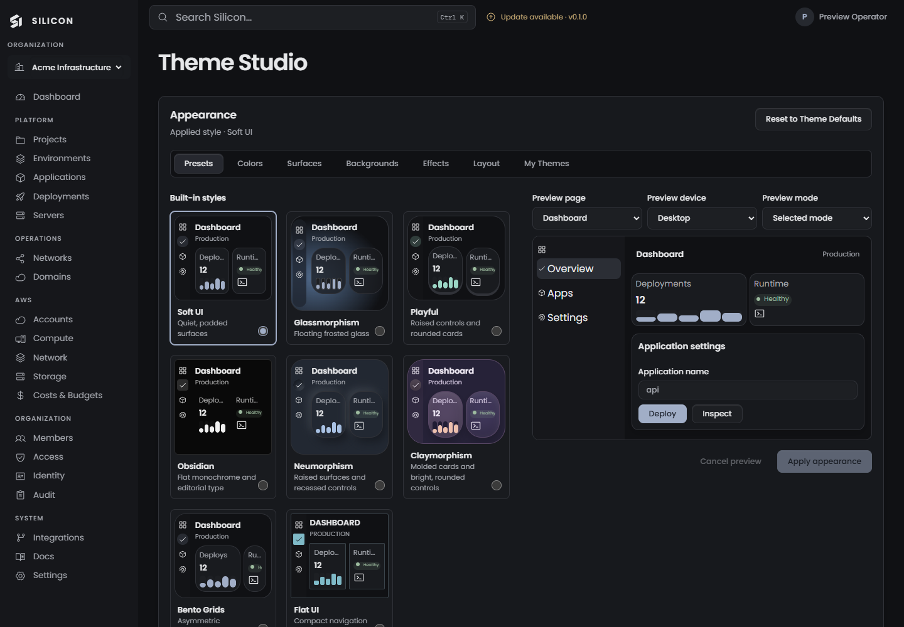
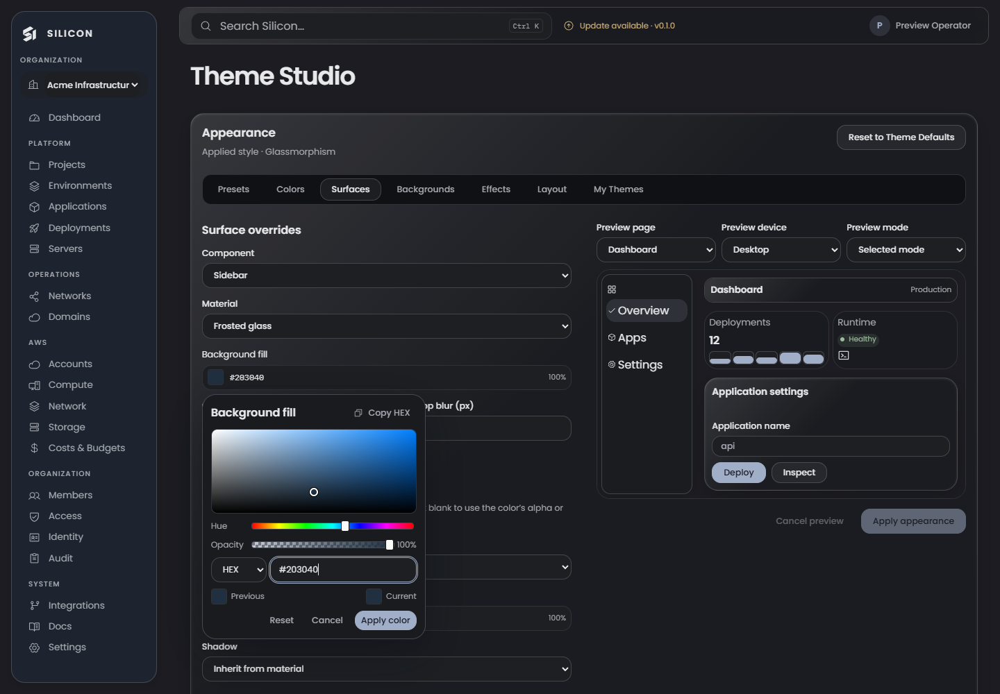
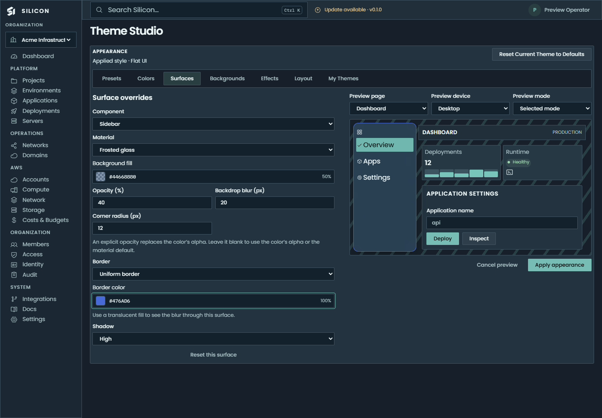

# Theme Studio

Open the menu beside your name and select **Theme Studio**. You can also open **Settings → Appearance → Open Theme Studio**. Each account has its own appearance, so your changes follow you when you sign in on another device.

## Choose and preview a style

1. Open **Presets** and choose a style. Try Glassmorphism for floating frosted surfaces, Flat UI for a compact solid layout, or Bento Grids for an asymmetric dashboard. Soft UI, Playful, Obsidian, Neumorphism, and Claymorphism are also available.
2. Use **Preview page** to switch between a dashboard, application, form, table, and dialog. Try **Preview device** and **Preview mode** to see the same draft on mobile or in the other color scheme. The preview contains example data and uses the selected style’s light or dark palette and navigation materials. Switching styles loads that style’s saved overrides.
3. Under **Layout**, choose light, dark, or system mode, then set density, sidebar treatment, content width, or dashboard layout. **Apply appearance** saves the draft. **Cancel preview** discards it.

## Pick a color and set its transparency

1. Open **Colors** and select a swatch. Drag in the square to set saturation and brightness, then adjust **Hue** and **Opacity**. With keyboard focus on the square, use arrow keys and hold **Shift** for bigger steps.
2. To enter an exact value, use **HEX**, **RGB**, or **RGBA**. For example, `#8896B3` is opaque, `#8896B380` is about 50% opaque, and `#8896B300` is transparent. The checkerboard shows how much of the background shines through.
3. **Apply color** commits the color to the draft. **Cancel**, Escape, or clicking outside closes the picker and discards that color edit. **Reset** restores the inherited color. **Copy HEX** copies the current value.
4. If you get a contrast warning, adjust the affected colors or use **Restore accessible palette defaults**. Check both light and dark if you plan to use system mode.

## Customize a surface

1. Open **Surfaces** and select a component such as **Sidebar**, **Cards**, or **Panels and sections**. Each can have its own fill, material, opacity, blur, border, radius, and shadow. Inputs, buttons, tables, and charts have additional controls. Selecting a component opens a preview that contains it. Picking a border color turns the border on.
2. For a frosted sidebar, choose **Frosted glass**, set **Opacity** to 40%, and set **Backdrop blur** to 20 px. To make application cards lighter, select **Cards**, use the same material, and try 20% opacity and 12 px blur. Set **Inputs** to **Solid** if you want an opaque field.
3. A surface opacity overrides the alpha in its fill. Leave opacity empty to use the fill’s alpha or the material default. Text and icons stay opaque. Use a translucent fill to see backdrop blur. A named widget override takes precedence over the shared dashboard widget setting. Use **Reset this surface** to clear the selected override.

## Set a background and motion

1. Open **Backgrounds**. Choose a solid color, linear/radial/mesh gradient, animated gradient, blurred blobs, or image. Pick **Placement** to limit where it appears.
2. To use your own image, choose a PNG, JPEG, or WebP up to 1 MiB. Adjust its fit, size, position, tiling, blur, opacity, brightness, saturation, or dark overlay. The account stores one private image shared by its themes. **Apply appearance** saves the image together with your theme.
3. Open **Effects** for motion and the available background controls. Glassmorphism also provides tint, saturation, reflection, and moving blob controls. Choose **Reduced Motion** or **No Motion** to turn off decorative animation. Silicon honors your device’s reduced-motion preference.

## Save, share, or reset a theme

1. Open **My Themes**, enter a name, and choose **Save custom preset**. Select **Apply appearance** to save it. You can store up to 12 presets.
2. To reuse a preset, select it and choose **Preview preset**, then **Apply appearance**. This tab also lets you rename, duplicate, reset, and delete a preset. Those changes are saved when you apply.
3. Use **Export theme** to download a versioned JSON file for the selected preset or current draft. To reuse it, choose **Import theme** and review the preview before applying. Your private account image is stored separately from the JSON.
4. **Reset Current Theme to Defaults** clears overrides for the selected built-in style. It keeps your other styles, saved presets, color mode, and density. Apply to make the reset permanent.
